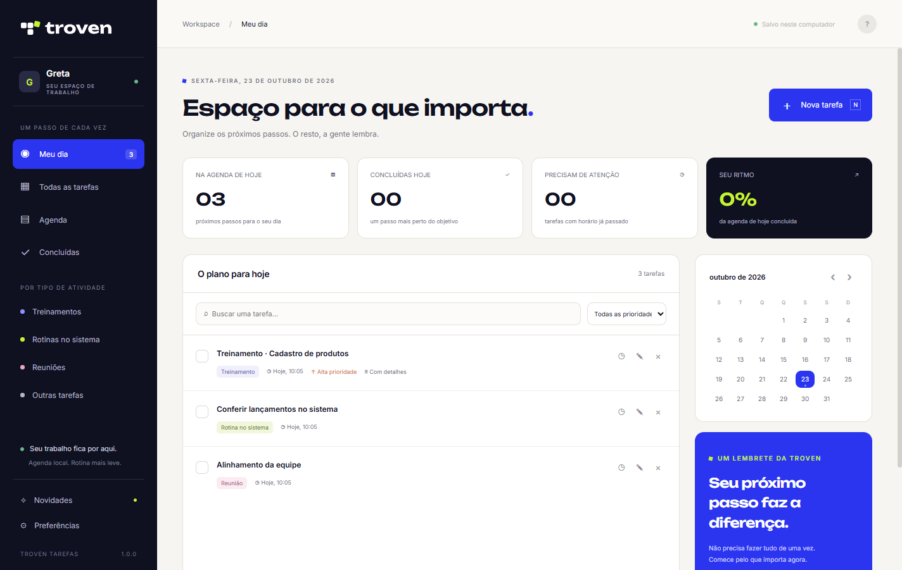

<p align="center">
  <picture>
    <source media="(prefers-color-scheme: dark)" srcset="app/assets/troven-horizontal-negativo.svg">
    
  </picture>
</p>

<h1 align="center">Sua rotina, no tempo certo.</h1>

<p align="center">Treinamentos, rotinas no sistema e compromissos.<br>Um lugar para organizar o próximo passo — e lembrar da hora de começar.</p>

<p align="center">
  <a href="https://github.com/TrovenDev/greta-todoo/releases/latest"></a>
  <a href="https://marca.troven.com.br"></a>
</p>

<p align="center">
  
  
  
</p>



## Menos coisa na cabeça. Mais espaço no dia.

| 01 · Coloque na agenda | 02 · Siga o seu ritmo | 03 · Deixe a gente lembrar |
| :--- | :--- | :--- |
| Defina a tarefa, o dia e a hora. Acrescente detalhes e prioridade. | Consulte **Meu dia**, busque suas tarefas ou escolha uma data na **Agenda**. | Receba um lembrete do Windows. Conclua ou adie por 10 minutos. |

**Primeiro acesso:** [baixe o instalador](https://github.com/TrovenDev/greta-todoo/releases/latest), execute `Troven-Tarefas-Setup-1.0.0.exe` e siga o assistente em português. Não precisa instalar Node.js ou outras ferramentas.

## Feito para a sua rotina

- **Treinamentos com hora marcada.** Coloque o assunto e os detalhes no mesmo lugar.
- **Rotinas no sistema.** Agende conferências, lançamentos e outras atividades.
- **Lembretes no momento certo.** Na hora, ou 5, 15, 30 ou 60 minutos antes.
- **Recorrência sem retrabalho.** Ao concluir uma tarefa diária ou semanal, a próxima ocorrência futura é criada. Horários seguem o fuso local do computador.
- **Prioridade e contexto.** Filtre atividades urgentes e guarde observações.
- **Conquistas visíveis.** Veja as tarefas concluídas e reabra quando precisar.
- **Por perto na bandeja.** Fechar a janela mantém o aplicativo em execução. Use **Preferências → Iniciar junto com o Windows** para manter a agenda por perto.
- **Identidade Troven.** Cobalto, lima, Inter e Unbounded; transições GSAP e animação Lottie incluídas localmente, respeitando a preferência por movimento reduzido.
- **Sua agenda tem continuidade.** Backup exportável e dados separados da instalação.

**Atalho:** pressione **N** para criar uma tarefa. O botão **?** apresenta o guia de uso.

### Como os lembretes funcionam

O computador precisa estar ligado e o aplicativo em execução, inclusive na bandeja. Ao retomar da suspensão ou abrir o aplicativo, os lembretes pendentes são verificados. O modo Não incomodar do Windows pode ocultar as notificações.

O lembrete é entregue uma vez por tarefa; editar ou adiar a tarefa permite um novo aviso. A recorrência cria a próxima tarefa ao concluir a atual e pula ocorrências antigas. A tela **Meu dia** reúne as tarefas de hoje e as atrasadas.

## Atualiza sozinho. Conta o que mudou.

1. O aplicativo instalado consulta as Releases oficiais ao abrir e a cada quatro horas.
2. Uma nova versão é baixada em segundo plano pelo `electron-updater`, com verificação do manifesto e hash SHA-512.
3. Saia pelo menu da bandeja para instalar, ou escolha **Reiniciar e atualizar** no aviso.
4. Na próxima abertura, a tela **Novidades** mostra as mudanças incluídas na versão. O histórico fica disponível offline.

Sem internet, a agenda continua funcionando. Em **Preferências**, também é possível verificar atualizações manualmente.

## Seus dados ficam com você

```text
%APPDATA%\Troven\Tarefas\tarefas.json
```

A gravação usa um arquivo temporário e mantém a versão anterior em `tarefas.json.bak`. Se a base estiver corrompida, o original é preservado e o aplicativo tenta recuperar o backup.

Use **Preferências → Exportar backup** para guardar uma cópia ou transferir a agenda. **Restaurar backup** solicita confirmação e preserva a base anterior em `.bak`. Atualizar ou desinstalar mantém os dados. Esta versão funciona por computador, sem sincronização de equipe.

## Desenvolvimento

Windows x64 e Node.js 24:

```powershell
npm ci
npm start
```

```powershell
npm test           # Persistência, recorrência, lembretes e recuperação
npm run smoke     # Fluxo real da interface Electron com dados isolados
npm run build     # Instalador Windows em dist/
```

O teste de interface usa `.test-data/`, sem acessar a agenda pessoal. A captura do README usa dados fictícios.

### Publicar uma atualização

1. Atualize `version` no `package.json` e execute `npm install --package-lock-only`.
2. Acrescente a versão, a data, o título e os itens em `app/releases.json`. Esse arquivo alimenta as novidades do aplicativo e as notas da release.
3. Execute os testes, faça commit e envie uma tag correspondente à versão:

```powershell
git tag v1.0.1
git push origin main --tags
```

A Action Windows valida a versão, roda os testes e publica o instalador `.exe`, o `.blockmap` e o `latest.yml`. Preserve esses três arquivos na Release: eles permitem a atualização automática. O workflow usa o `GITHUB_TOKEN` com permissão de escrita em conteúdo.

Para publicação local, configure `GH_TOKEN` no ambiente e execute `npm run release`. Não grave tokens no repositório. O canal de atualização deve ser acessível aos computadores clientes; repositórios privados precisam de uma distribuição pública ou de um provedor autenticado próprio.

O instalador gerado localmente não tem certificado de assinatura de código. Para distribuição assinada, configure as credenciais de assinatura do Electron Builder no ambiente de build.

### Estrutura

```text
app/
  main.cjs          Janela, bandeja, notificações e atualizações
  preload.cjs       API isolada para a interface
  core.cjs          Persistência e regras da agenda
  renderer.js       Tarefas, calendário, preferências e novidades
  releases.json     Histórico de versões incluído no aplicativo
  assets/           Identidade e fontes oficiais da Troven
  vendor/           GSAP e Lottie para uso offline
scripts/            Empacotamento, notas e verificação da interface
tests/              Verificações das regras e dos dados
.github/workflows/  Publicação automática por tag
```

Identidade visual: [marca.troven.com.br](https://marca.troven.com.br). As bibliotecas e fontes seguem suas respectivas licenças.
